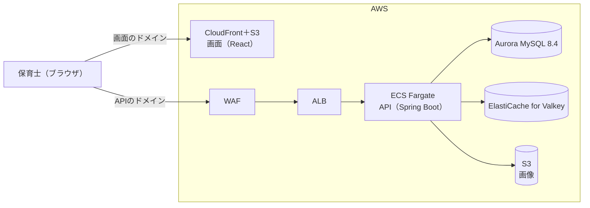
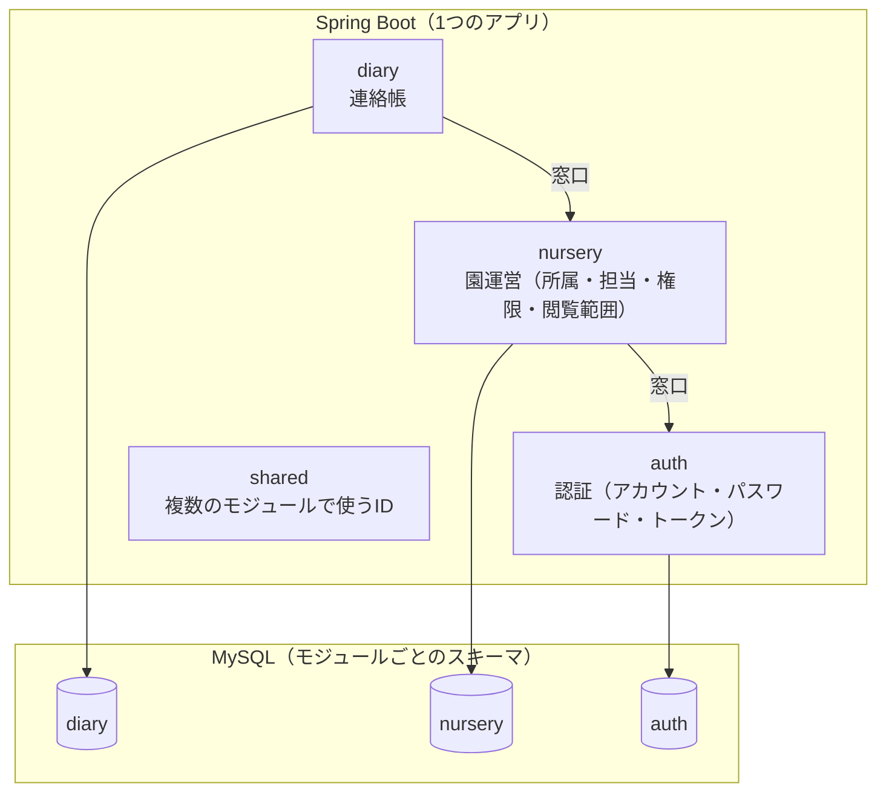
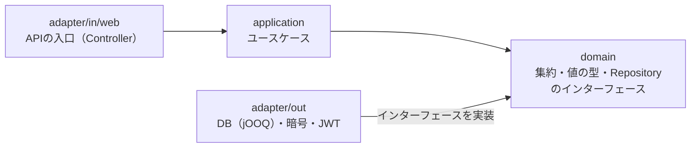

# HoikuLink

保育施設向けSaaSを想定した、保育士用の連絡帳Webアプリ。
要件定義からAWSでの公開までを一人で一貫して行うポートフォリオ。
保育士の勤怠や園児の登降園の管理など、園運営の情報を使う業務への拡張を見据えた構成。

## 開発の目的

保育の授業や保育園での職業体験で保育士の仕事に触れ、保育のICT化に関心を持ったことがきっかけ。
保育士が毎日書く連絡帳を題材に、次の2つを満たすシステムの設計・実装を目的とする。

- **現場の業務への適合**：「誰が・いつ・何を書き、誰が確認するか」という保育士の1日の流れを起点にした要件定義。
- **大規模なサービスとしての成立**：2.5万園・園児250万人の規模の想定と、園児の個人情報を守る認証・認可、機能の追加に強い構成。

## 開発状況

**①ログインが画面まで完成。** 機能ごとに、API・画面・テストまで終えてから次の機能へ進める進め方。

| 順番 | 機能 | 状況 | 完了予定 |
|---|---|---|---|
| ① | ログイン（ログイン・トークンの再発行・ログアウト、ログイン画面） | ✅ 完成 | 2026-10-20（完了） |
| ② | 園の選択・権限・閲覧範囲 | 🔶 次に実装 | 2026-11-20 |
| ③ | 連絡帳の一覧・詳細 | ⬜ 未着手 | 2026-12-11 |
| ④ | 連絡帳の作成・編集・削除 | ⬜ 未着手 | 2027-01-15 |
| ⑤ | 認証の残り（パスワードの変更・履歴・漏洩照合、初期パスワードの強制変更、ロックの一覧・解除、無操作15分の自動ログアウト） | ⬜ 未着手 | 2027-02-19 |
| ⑥ | 画像（アップロード、位置情報の除去、閲覧、削除） | ⬜ 未着手 | 2027-03-12 |
| ⑦ | AWSへのデプロイ（E2Eテスト・デモ動画を含む） | ⬜ 未着手 | 2027-04-16 |

## 機能

### 実装済み（①ログイン）

- **認証**：メールアドレス・パスワードでのログイン（Argon2idでハッシュ化）。
- **総当たり攻撃への対策**：5回連続の失敗でアカウントをロック／応答のメッセージと処理時間の統一（アカウントの有無の秘匿）。
- **トークンの管理**
  - Access Token（JWT／有効期限5分）。
  - Refresh Token（DBに保存するランダムな文字列／有効期限12時間／利用ごとに交換／使い回しの検知で同じログインのトークンをすべて無効化）。
- **CSRF対策**：`SameSite=Strict`／カスタムヘッダー（`X-Requested-With`）／Originの検証。
- **ログイン画面（React）**：Access Tokenはメモリだけに保持／再読み込み時はRefresh Tokenで自動で再取得。

### 次に実装（②〜④）

- **園の選択**：所属する園の選択。
- **認可**：役職ごとの権限／閲覧範囲（担当の園児だけを表示）。
- **APIの保護**：Access Tokenの検証／ログアウト時のAccess Tokenの即時無効化。
- **連絡帳**：一覧・検索・詳細・作成・編集・削除（同時の編集の検知を含む）。

### 未実装（公開版に含める）

- **パスワード**：15〜64文字のルール／漏洩済みパスワードの拒否／過去5世代の再利用の禁止／変更。
- **アカウント**：初期パスワードと初回ログイン時の変更の強制／アカウントの停止の確認／園長・主任によるロックの解除。
- **セッション**：無操作15分での自動ログアウト。
- **画像**：位置情報の除去／署名付きURLでの配信。
- **公開**：AWSへのデプロイ／E2Eテスト／デモ動画。

### 公開後の追加要件

- **可用性**：2つのアベイラビリティゾーンでの冗長化／障害対応の試験。
- **連絡帳**：既読管理／下書き／編集履歴。
- **アカウント**：時間の経過によるロックの自動解除。
- **管理**：保育士の管理／役職ごとの権限の設定画面。

## 構成

### システム構成（本番、⑦で構築予定）



- 画面とAPIは別のドメイン。APIはCloudFrontを通さずALBで受信。
- 初期公開は最小の構成（ECS 1タスク、DB 1台）。ネットワークは2つのアベイラビリティゾーンへ拡張できる形で先に構築。

### モジュールと層

1つのSpring Bootのアプリの中を、業務ごとのモジュールに分割（モジュラーモノリス）。
モジュール間の呼び出しは、各モジュールの窓口（`api`パッケージ）経由に限定。DBもモジュールごとにスキーマを分離。



各モジュールの中は、クリーンアーキテクチャの層に分割。依存の向きは外側から内側（`domain`）への一方向。



モジュールの境界はSpring Modulith、層の依存の向きはArchUnitのテストで検証。違反はCIで検出。

## 技術スタック

### バックエンド

| 分類 | 技術 |
|---|---|
| 言語 | Java 21 |
| フレームワーク | Spring Boot 4.1.1／Spring Security |
| アーキテクチャ | モジュラーモノリス（Spring Modulith）／クリーンアーキテクチャ／DDD |
| DBアクセス | jOOQ |
| DBマイグレーション | Flyway（モジュールごと） |
| ビルド | Gradle（Kotlin DSL） |
| テスト | JUnit／Mockito／Testcontainers／ArchUnit |
| コードの品質 | Spotless（palantir-java-format）／Checkstyle |

### フロントエンド

| 分類 | 技術 |
|---|---|
| 言語 | TypeScript |
| フレームワーク | React／React Router |
| ビルド | Vite |
| テスト | Vitest／Testing Library |
| コードの品質 | ESLint |

### データベース・キャッシュ

| 分類 | 技術 |
|---|---|
| データベース | Aurora MySQL 8.4（ローカル環境：MySQL 8.4） |
| キャッシュ | ElastiCache for Valkey（ローカル環境：Valkey） |
| ファイル保存 | Amazon S3 |

### インフラ（⑦で構築予定）

| 分類 | 技術 |
|---|---|
| クラウド | AWS（ECS Fargate／ALB／CloudFront／S3／Aurora／ElastiCache／WAF） |
| IaC | AWS CDK（Java） |
| コンテナ | Docker／Docker Compose |
| 監視 | Amazon CloudWatch |

### 開発プロセス

| 分類 | 内容 |
|---|---|
| 開発手法 | アジャイル（機能ごとの短い反復）＋XPのプラクティス（TDD・CI・リファクタリング・コーディング規約） |
| CI | GitHub Actions（バックエンド・画面それぞれでLint・テスト・ビルド） |
| セキュリティの確認 | CodeQL／Dependabot |
| ブランチ運用 | GitHub Flow |

## 主な設計判断

複数の案の比較と、公式ドキュメントを根拠にした判断。主なものを「決定・理由・選ばなかった案・根拠」で記載。

### 1. 業務ごとのモジュラーモノリス

- **決定**：1つのSpring Bootの中を、認証・園運営・連絡帳のモジュールに分割。モジュール間の呼び出しは窓口経由に限定し、DBのスキーマも分離。
- **理由**
  - モジュール分割による変更容易性の確保と、一人での複数サービスの運用負担の回避。
  - 将来の業務（登降園管理など）を、モジュール単位で切り出し可能。
- **選ばなかった案**
  - 保育士用と保護者用のマイクロサービス（保育士の検索のたびに保護者側のサービスを呼び出し、片方の停止で両方が停止）。
  - 単純なモノリス（変更に弱い構成）。
- **根拠**：[Spring Modulith リファレンス](https://docs.spring.io/spring-modulith/reference/)

### 2. 境界と依存の向きのテストによる検証

- **決定**：モジュールの境界はSpring Modulith、モジュールの中の層の依存の向き（domainがadapterに依存しないなど）はArchUnitのテストで検証。
- **理由**
  - DDDとクリーンアーキテクチャの境界を、開発者の注意ではなく仕組みで維持。
  - 違反はCIで自動的に検出。
- **選ばなかった案**
  - ArchUnitだけでの検証（モジュールの境界のルールを自作する必要あり）。
  - テストでの検証なし。
- **根拠**：[Spring Modulith：Verifying Application Module Structure](https://docs.spring.io/spring-modulith/reference/verification.html)、[ArchUnit ユーザーガイド](https://www.archunit.org/userguide/html/000_Index.html)

### 3. IDや業務の値の型（Value Object）化

- **決定**：ID・メールアドレス・パスワードなどを、Javaの`record`による変更できない型として定義。
- **理由**
  - 園児IDの位置に保育士IDを渡すような取り違えを、コンパイルエラーとして検出。
  - 値のルールを1か所に集約し、テストも容易。
- **選ばなかった案**
  - 文字列や数値のままの扱い（取り違えを防げず、ルールが分散）。
- **根拠**：[Microsoft Learn：戦術的DDDを使用してマイクロサービスを設計する](https://learn.microsoft.com/ja-jp/azure/architecture/microservices/model/tactical-domain-driven-design)

### 4. 閲覧範囲の型化と、検索の必須の引数化

- **決定**：見てよい園児の一覧を表す型（`ViewableScope`）を園運営モジュールだけが作成でき、すべての検索メソッドの必須の引数とする。
- **理由**
  - 検索の条件の書き忘れは、そのまま園児の個人情報の漏洩につながる。
  - 型での強制により、範囲を渡さない検索はコンパイル不可。
- **選ばなかった案**
  - SQLごとに条件を手で記述（1か所の書き忘れで漏洩）。
  - DBの行レベルのセキュリティ（MySQLに機能なし）。
  - JWTへの担当のクラスの格納（担当の変更がすぐに反映されない）。
- **根拠**：[OWASP Authorization Cheat Sheet](https://cheatsheetseries.owasp.org/cheatsheets/Authorization_Cheat_Sheet.html)、[OWASP Insecure Direct Object Reference Prevention Cheat Sheet](https://cheatsheetseries.owasp.org/cheatsheets/Insecure_Direct_Object_Reference_Prevention_Cheat_Sheet.html)

### 5. 役職ではなく権限による判定

- **決定**：コードは「権限を持っているか」だけで判定し、役職と権限の対応は園ごとにDBで管理。
- **理由**
  - 園によって役職のできることが異なる。
  - 園ごとの違いはデータの変更だけで対応でき、判定のコードは変更不要。
- **選ばなかった案**
  - 役職の名前での判定（園ごとに変更できず、変更のたびに全園へのデプロイが必要）。
  - 対応のコードへの固定。
- **根拠**：[OWASP Authorization Cheat Sheet](https://cheatsheetseries.owasp.org/cheatsheets/Authorization_Cheat_Sheet.html)

### 6. 短いJWTのAccess Tokenと、交換するランダムな文字列のRefresh Token

- **決定**：Access TokenはJWT（有効期限5分、権限は含めない）。Refresh Tokenはランダムな文字列とし、DBにはハッシュ値だけを保存。利用ごとに交換し、使い回しの検知で同じログインのトークンをすべて無効化。有効期限はログインから12時間で、`HttpOnly`のCookieに保存。
- **理由**
  - JWTに権限を持たせないことによる、役職や担当の変更後に古い権限のまま操作できる問題の防止（変更は1分以内に反映）。
  - 共用のタブレットでログアウトを忘れても、翌日には必ず再ログイン。
  - `HttpOnly`のCookieの採用による、XSSでのトークンの奪取のリスクの最小化。
- **選ばなかった案**
  - Refresh TokenもJWT（失効の確認にDBが必要で利点なし）。
  - 有効期限30日（なりすましが可能な期間が長い）。
  - localStorageへの保存（XSSで読み取り可能）。
- **根拠**：[RFC 9700 OAuth 2.0 Security Best Current Practice](https://www.rfc-editor.org/rfc/rfc9700)、[OWASP JSON Web Token Cheat Sheet](https://cheatsheetseries.owasp.org/cheatsheets/JSON_Web_Token_for_Java_Cheat_Sheet.html)

### 7. SameSite・カスタムヘッダー・Originの検証の3つを重ねたCSRF対策

- **決定**：Cookieを使うAPIを認証の3つ（ログイン・再発行・ログアウト）に限定し、Cookieに`SameSite=Strict`を付与。再発行とログアウトでは、カスタムヘッダー（`X-Requested-With`）とOriginの一致を検証。ほかのAPIはCookieを使わず、Access Tokenをヘッダーで送信。
- **理由**
  - カスタムヘッダーは、別のサイトから送るとCORSの事前確認が必要になり、許可していないサイトからは送信不可。
  - どれも数行で実装でき、1つが破られても他で防御。
- **選ばなかった案**
  - SameSiteのみ（古いブラウザや特定の構成で不十分なリスクあり）。
  - 従来型のCSRFトークン（SPA＋REST APIの構成では、カスタムヘッダーとOriginの検証で同等の効果をより簡単に実現できるため）。
- **根拠**：[OWASP Cross-Site Request Forgery Prevention Cheat Sheet](https://cheatsheetseries.owasp.org/cheatsheets/Cross-Site_Request_Forgery_Prevention_Cheat_Sheet.html)、[MDN：Set-Cookie（SameSite）](https://developer.mozilla.org/ja/docs/Web/HTTP/Reference/Headers/Set-Cookie)

### 8. Argon2idでのパスワードの保存、5回の失敗でのロック、アカウントの有無の秘匿

- **決定**：パスワードはArgon2id（メモリ12MiB・反復3回）でハッシュ化。5回連続の失敗でロック。存在しないメールアドレスでもダミーのハッシュ値で照合し、失敗のメッセージと処理時間を統一。
- **理由**
  - Argon2idはOWASPの第一候補。朝の一斉ログインでのメモリ不足を避けるため、OWASPが同じ強さとして示す設定のうちメモリの少ないものを採用。
  - メッセージと処理時間の両方で、攻撃者にアカウントの有無を知らせない。
- **選ばなかった案**
  - BCrypt（GPUによる解読への耐性がArgon2idより弱い）。
  - 存在しないときは照合しない（処理時間の差でアカウントの有無が判明）。
- **根拠**：[OWASP Password Storage Cheat Sheet](https://cheatsheetseries.owasp.org/cheatsheets/Password_Storage_Cheat_Sheet.html)、[OWASP Authentication Cheat Sheet](https://cheatsheetseries.owasp.org/cheatsheets/Authentication_Cheat_Sheet.html)、[NIST SP 800-63B-4](https://pages.nist.gov/800-63-4/sp800-63b.html)

### 9. 例外ではなく結果の型を返すログインのユースケース

- **決定**：ログインの成功・失敗・ロックを、`sealed`の結果の型で返却。APIの入口で401などに変換。
- **理由**
  - 例外を投げるとトランザクションが取り消され、失敗の回数の書き込みが消えてロックされない。
  - `sealed`により、結果の種類を増やしたときの扱い漏れをコンパイルエラーとして検出。
- **選ばなかった案**
  - 例外を投げ、その例外では取り消さない設定（設定を忘れても気づきにくい）。
  - 失敗の記録だけ別のトランザクション（仕組みが複雑）。
- **根拠**：[Spring Framework：Rolling Back a Declarative Transaction](https://docs.spring.io/spring-framework/reference/data-access/transaction/declarative/rolling-back.html)

### 10. セキュリティを優先した公開版の範囲

- **決定**：個人情報の保護と不正アクセスの防止に関わる機能はすべて公開版に含める。業務の機能は連絡帳のCRUDに絞り、既読管理・下書き・2つのアベイラビリティゾーンでの冗長化などは公開後に追加。
- **理由**
  - 保育の個人情報を扱うサービスで、後からの追加が難しく、欠けると信頼を損なうのはセキュリティ。
  - 業務の機能はCRUDの完成後に追加しやすい。
- **選ばなかった案**
  - セキュリティを後回しにした連絡帳の機能の優先（公開の時点で個人情報の保護が不十分）。
- **根拠**：[AWS Well-Architected フレームワーク](https://docs.aws.amazon.com/ja_jp/wellarchitected/latest/framework/welcome.html)

### そのほかの判断

- **APIのエラー**：[RFC 9457](https://www.rfc-editor.org/rfc/rfc9457)（Problem Details）の形式に独自のエラーコードを追加。
- **ID**：「3文字のプレフィックス＋ULID」の形式（ログやDBで対象の種類を判別可能）。
- **マイグレーションとコード生成**：FlywayのマイグレーションとjOOQのコード生成をモジュールごとに分割（新しいモジュールはフォルダの追加だけで対応）。

## 開発プロセス・AIの活用

本プロダクトの開発では、開発スピードの最大化と未知の技術領域（インフラ・環境構築など）のキャッチアップを効率化するため、AI（Claude）を「ペアプログラミングパートナー・壁打ち相手」として積極的に活用した。

### 要件定義は自ら行う

保育の授業や保育園での職業体験で知った保育士の仕事をもとに、連絡帳を書く・確認する業務の流れを想定し、利用者・機能・画面などの要件を自分で考えて要件定義書にまとめた。連絡帳の記入項目や保育士の役職は、公開されている情報や実際の連絡帳を調べて決定した。
セキュリティの要件と規模の想定（2.5万園・250万園児）は、AIと検討を重ねて決定した。

### 主体的な意思決定と設計

要件定義や技術選定、アーキテクチャ設計においては、AIから複数の選択肢・構成案を提示させた上で、プロダクトの目的や拡張性・コスト（トレードオフ）を自ら比較・検討して判断を行った。

### 一次情報（公式ドキュメント）による検証

技術の比較・判断では、公式ドキュメント（OWASP・MDN・Spring・AWSなど）を根拠にしている。主な判断と理由は「[主な設計判断](#主な設計判断)」の章に記載した。
未知の領域（Dockerによる開発環境、CI/CD、認証（Spring Security・JWT）など）では、まずAIでプロトタイプや全体像を迅速に構築し、その後、生成された設定ファイルやコードの役割・仕組みを1行ずつ読み解き、公式ドキュメントで裏取りを行う。ブラックボックスのまま運用しないことを方針としている。
英語の公式ドキュメントやRFCなどの一次情報は、翻訳ツールやAIを補助として全体の要点を把握した上で、原文のコード例や仕様の該当箇所を自分の目で確認する。
読み解きと裏取りは機能ごとに進めており、状況は下の表のとおり。

| 対象機能・領域 | 解読および公式ドキュメントでの裏取り状況 | 完了予定 |
|---|---|---|
| 開発環境（Docker・Gradle・CI/CD） | 🔶 実施中 | 2026-10-31 |
| ①ログイン（API・画面） | 🔶 実施中 | 2026-10-31 |
| ②以降の機能 | 実装と並行して実施 | 各機能の完了時 |

### トラブルシューティングとナレッジ化

開発・構築中に発生したエラーや想定外の挙動は、エラーの原因やログのメカニズムをAIとともに解析して解決し、原因と解決策を記録して、復習やキャッチアップに活かしている。

## ローカル環境での起動方法

### 必要なもの

- Docker Desktop（MySQL・Valkeyの起動と、jOOQのコード生成で使用）
- Java 21（Amazon Corretto 21）
- Node.js 24

### 1. APIの起動

```bash
cd backend
# JWTの署名の鍵（32バイト以上のランダムな値）を環境変数に設定
export HOIKULINK_JWT_SECRET=$(openssl rand -base64 32)
# 起動時にDocker ComposeでMySQLとValkeyも起動
./gradlew bootRun
```

### 2. ローカル環境専用のデモのアカウントの作成

APIを起動したまま、別のターミナルで実行。メールアドレスとパスワードはスクリプトの先頭に記載（ローカル環境だけで使用するアカウント）。

```bash
cd backend
bash scripts/create-demo-account.sh
```

### 3. 画面の起動

```bash
cd frontend
npm ci
npm run dev
```

ブラウザで http://localhost:5173 を開き、2で作成したアカウントでログイン。

### テスト

```bash
# バックエンド（整形・書き方のルール・テスト）
cd backend && ./gradlew check

# 画面（Lint・テスト）
cd frontend && npm run lint && npm test
```

`docker compose up`だけで画面とAPIを起動できる形には今後対応予定。

## ドキュメント

### 基本設計

- [画面一覧](docs/basic-design/04_screen-list.md)
- [API一覧](docs/basic-design/07_api-list.md)
- [ER図](docs/basic-design/08_database-overview.md)

### 詳細設計

- [テーブル定義](docs/detailed-design/database/table-design.md)
- [ドメイン：アカウント（認証）](docs/detailed-design/domain/auth/user-account.md)
- [ドメイン：トークン](docs/detailed-design/domain/auth/token.md)
- [API：ログイン](docs/detailed-design/api/auth/login.md)
- [API：トークンの再発行](docs/detailed-design/api/auth/refresh.md)
- [API：ログアウト](docs/detailed-design/api/auth/logout.md)
