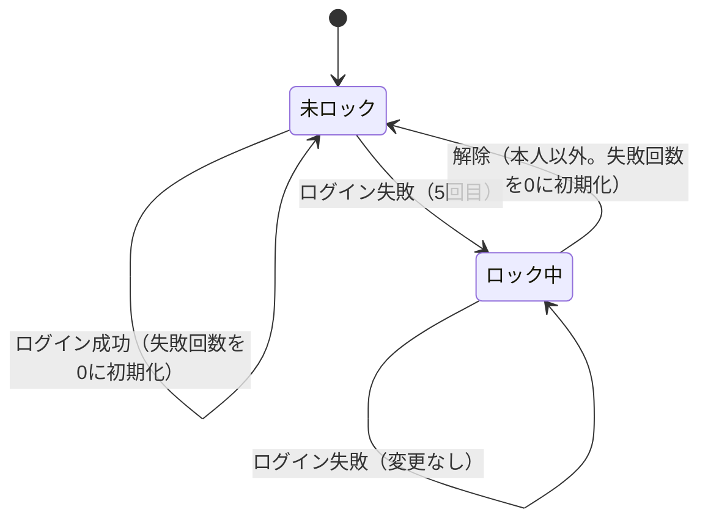

# ドメイン詳細設計書：UserAccount（認証）

| 項目 | 内容 |
|---|---|
| 状態 | 確定 |
| 版 | 1.0（初版） |
| モジュール | 認証 |
| パッケージ | `io.github.kawashima_study.hoikulink.auth.domain` |
| 対象範囲 | ユーザーID、メールアドレス、パスワードハッシュ、ログイン失敗とアカウントロック |

## 1. 概要

### 1-1. 集約名

UserAccount（アカウント）

### 1-2. 目的

ログインに必要な情報（ログインID・パスワードハッシュ）と、ログイン失敗によるロックの状態を持つ。
5回連続でログインに失敗するとアカウントをロックし、解除は園長・主任が行う。自分自身のロックは解除できない。
※解除可否の確認は園運営モジュールにて行う。

## 2. クラス一覧

| No. | クラス名 | 分類 | 概要 |
|---:|---|---|---|
| 1 | `UserAccount` | 集約ルート（Entity） | アカウント。ログインの失敗・成功の記録と、ロックの解除を受け付ける。 |
| 2 | `EmailAddress` | Value Object | ログインID（メールアドレス）。 |
| 3 | `PasswordHash` | Value Object | パスワードのハッシュ値。 |
| 4 | `LoginLock` | Value Object | ログインの失敗回数とロックの状態。変更時は新しい `LoginLock` を返す。 |
| 5 | `AuthErrorCode` | 列挙型（`ErrorCode` を実装） | 認証モジュールのエラーコードの一覧。 |
| 6 | `InvalidEmailAddressException` | 例外（`ApplicationException` を継承） | メールアドレスの長さ・形式の誤り。 |
| 7 | `SelfUnlockNotAllowedException` | 例外（`ApplicationException` を継承） | 自分自身のロックの解除。 |

## 3. 属性定義

### 3-1. UserAccount

| No. | 項目名 | 型 | 必須 | 制約 | 備考 |
|---:|---|---|:---:|---|---|
| 1 | `userId` | `UserId` | ○ | | ユーザーID（`USR`＋ULID）。アカウントを識別する。 |
| 2 | `emailAddress` | `EmailAddress` | ○ | | ログインID。 |
| 3 | `passwordHash` | `PasswordHash` | ○ | | パスワードのハッシュ値。 |
| 4 | `loginLock` | `LoginLock` | ○ | | ログインの失敗回数とロックの状態。 |

### 3-2. EmailAddress

| No. | 項目名 | 型 | 必須 | 制約 | 備考 |
|---:|---|---|:---:|---|---|
| 1 | `value` | `String` | ○ | 254文字以内（Javaの文字数）であること。空白を含まないこと。`@` は1つのみとし、`@` の前に1文字以上あり、`@` の後ろが「1文字以上＋`.`＋1文字以上」を含むこと。 | 前後の空白を取り除き、小文字にそろえた値。空白は、Javaの `Character.isWhitespace` が空白とみなす文字（全角空白を含む）とする。 |

### 3-3. PasswordHash

| No. | 項目名 | 型 | 必須 | 制約 | 備考 |
|---:|---|---|:---:|---|---|
| 1 | `value` | `String` | ○ | 空文字列、または空白のみでないこと。 | パスワードのハッシュ値。 |

### 3-4. LoginLock

| No. | 項目名 | 型 | 必須 | 制約 | 備考 |
|---:|---|---|:---:|---|---|
| 1 | `failedCount` | `int` | ○ | 未ロックの場合は0〜4、ロック中の場合は5であること。 | 連続したログインの失敗回数。 |
| 2 | `lockedAt` | `Instant` | | ロック中のみ値があること。 | ロックした日時。 |
| 3 | `unlockedAt` | `Instant` | | `unlockedBy` と、両方とも値がないか、両方とも値があること。 | 最後に解除した日時。 |
| 4 | `unlockedBy` | `UserId` | | `unlockedAt` と、両方とも値がないか、両方とも値があること。 | 最後に解除した園長・主任のユーザーID。 |

## 4. メソッド定義

### 4-1. UserAccount

| No. | メソッド名 | 引数 | 戻り値 | 例外 | 処理概要 |
|---:|---|---|---|---|---|
| 1 | `restore` | `UserId`、`EmailAddress`、`PasswordHash`、`LoginLock` | `UserAccount` | `NullPointerException`（いずれかの引数が `null`） | 保存されている値からアカウントを作成する。 |
| 2 | `recordLoginFailure` | `Instant`（失敗日時） | なし | `NullPointerException`（失敗日時が `null`） | ログインの失敗を記録し、5回目の失敗でロックする。ロック中は変更しない。 |
| 3 | `recordLoginSuccess` | なし | なし | `IllegalStateException`（ロック中） | 失敗回数を0に初期化する。 |
| 4 | `unlock` | `Instant`（解除日時）、`UserId`（解除者） | なし | `SelfUnlockNotAllowedException`（解除者が本人）、`NullPointerException`（解除日時・解除者が `null`） | 解除者が本人の場合は、ロックの有無にかかわらず例外とする。ロックを解除し、失敗回数を0に初期化して、解除日時と解除者を記録する。ロックされていないときは変更しない。 |
| 5 | `isLocked` | なし | `boolean` | | ロック中の場合 `true` を返す。 |
| 6 | `userId`、`emailAddress`、`passwordHash`、`loginLock` | なし | 各項目の型 | | 各項目の値を返す。 |

### 4-2. EmailAddress

| No. | メソッド名 | 引数 | 戻り値 | 例外 | 処理概要 |
|---:|---|---|---|---|---|
| 1 | コンストラクタ | `String` | | `NullPointerException`（`null`）、`InvalidEmailAddressException`（254文字超過、形式の誤り） | 次の順に処理する。①`null` を確認する。②前後の空白を取り除く。③ロケールに依存せずに小文字にそろえる（`Locale.ROOT`）。④②③の後の値で長さを確認する。⑤形式を確認する。 |
| 2 | `value` | なし | `String` | | 値を返す。 |
| 3 | `toString` | なし | `String` | | 中身を隠した文字列を返す（例：`EmailAddress[***]`）。 |

### 4-3. PasswordHash

| No. | メソッド名 | 引数 | 戻り値 | 例外 | 処理概要 |
|---:|---|---|---|---|---|
| 1 | コンストラクタ | `String` | | `NullPointerException`（`null`）、`IllegalArgumentException`（空文字列、または空白のみ） | 値を確認する。 |
| 2 | `value` | なし | `String` | | 値を返す。 |
| 3 | `toString` | なし | `String` | | 中身を隠した文字列を返す。 |

### 4-4. LoginLock

| No. | メソッド名 | 引数 | 戻り値 | 例外 | 処理概要 |
|---:|---|---|---|---|---|
| 1 | `initial` | なし | `LoginLock` | | 失敗回数0、ロックなしの状態を作成する。 |
| 2 | `restore` | `int`（失敗回数）、`Instant`（ロック日時）、`Instant`（解除日時）、`UserId`（解除者） | `LoginLock` | `IllegalArgumentException`（属性定義の制約を満たさない組み合わせ） | 保存されている値から作成する。 |
| 3 | `recordFailure` | `Instant`（失敗日時） | `LoginLock` | `NullPointerException`（失敗日時が `null`） | 失敗回数を1増やす。5回目でロックし、その日時をロック日時とする。ロック中は同じ状態を返す。 |
| 4 | `recordSuccess` | なし | `LoginLock` | `IllegalStateException`（ロック中） | 失敗回数を0に初期化する。 |
| 5 | `unlock` | `Instant`（解除日時）、`UserId`（解除者） | `LoginLock` | `NullPointerException`（解除日時・解除者が `null`） | ロック日時を消去し、失敗回数を0に初期化して、解除日時・解除者を記録する。ロックされていないときは同じ状態を返す。 |
| 6 | `isLocked` | なし | `boolean` | | ロック日時がある場合 `true` を返す。 |
| 7 | `failedCount` | なし | `int` | | 失敗回数を返す。 |
| 8 | `lockedAt` | なし | `Optional<Instant>` | | ロック日時を返す。値がない場合は空を返す。 |
| 9 | `unlockedAt` | なし | `Optional<Instant>` | | 解除日時を返す。値がない場合は空を返す。 |
| 10 | `unlockedBy` | なし | `Optional<UserId>` | | 解除者を返す。値がない場合は空を返す。 |

## 5. 業務ルール（不変条件）

| No. | 業務ルール | 実装箇所 | 違反時の動作 |
|---:|---|---|---|
| 1 | 5回連続でログインに失敗した場合、ロックする。 | `LoginLock.recordFailure` | ― |
| 2 | ロック中はログインできない。 | `UserAccount.recordLoginSuccess`、`LoginLock.recordSuccess` | `IllegalStateException` |
| 3 | ロック中に失敗しても、失敗回数・ロック日時は変更しない。 | `LoginLock.recordFailure` | ― |
| 4 | ログインに成功した場合、失敗回数を0に初期化する。 | `LoginLock.recordSuccess` | ― |
| 5 | 解除した場合、失敗回数を0に初期化する。 | `LoginLock.unlock` | ― |
| 6 | メールアドレスは小文字にそろえる。 | `EmailAddress` | ― |
| 7 | メールアドレスは254文字以内で、メールアドレスの形式であること。 | `EmailAddress` | `InvalidEmailAddressException` |
| 8 | 失敗回数とロック日時は、未ロック（失敗回数0〜4・ロック日時なし）か、ロック中（失敗回数5・ロック日時あり）のいずれかであること。 | `LoginLock` | `IllegalArgumentException` |
| 9 | 解除日時と解除者は、両方とも値がないか、両方とも値があること。 | `LoginLock` | `IllegalArgumentException` |
| 10 | 自分自身のロックは解除できない。 | `UserAccount.unlock` | `SelfUnlockNotAllowedException` |

## 6. 例外定義

| No. | 例外クラス | エラーコード | 発生条件 |
|---:|---|---|---|
| 1 | `InvalidEmailAddressException`（`ApplicationException` を継承） | `INVALID_EMAIL_ADDRESS`（`AuthErrorCode`） | メールアドレスが254文字を超える、または形式が誤っている。 |
| 2 | `NullPointerException` | ― | メールアドレス・パスワードハッシュ・失敗日時・解除日時・解除者に `null` が渡された。または、アカウントの復元でユーザーID・メールアドレス・パスワードハッシュ・ログインの失敗回数とロックの状態のいずれかに `null` が渡された（プログラム、または保存データの誤り）。 |
| 3 | `IllegalArgumentException` | ― | パスワードハッシュが空文字列、または空白のみ。`LoginLock` の復元で、属性定義の制約を満たさない組み合わせが渡された（プログラム、または保存データの誤り）。 |
| 4 | `IllegalStateException` | ― | ロック中にログイン成功の記録が呼ばれた（プログラムの誤り）。 |
| 5 | `SelfUnlockNotAllowedException`（`ApplicationException` を継承） | `SELF_UNLOCK_NOT_ALLOWED`（`AuthErrorCode`） | 解除者のユーザーIDが、アカウントのユーザーIDと同じ。 |

### 6-1. エラーコード（`AuthErrorCode`）

| No. | エラーコード | 用途 | タイトル（`title`） | 詳細（`detail`） |
|---:|---|---|---|---|
| 1 | `INVALID_EMAIL_ADDRESS` | メールアドレスの長さ・形式の誤り。 | メールアドレスの形式が正しくありません。 | 254文字以内の正しい形式のメールアドレスを入力してください。 |
| 2 | `SELF_UNLOCK_NOT_ALLOWED` | 自分自身のロックの解除。 | 自分のアカウントのロックは解除できません。 | ほかの園長または主任にロックの解除を依頼してください。 |

※タイトルはエラーの種類の説明、詳細は利用者が問題を直すための説明とする。どちらにも入力された値を含めない。

## 7. 状態遷移

| No. | 状態 | 条件 |
|---:|---|---|
| 1 | 未ロック | ロック日時がない。 |
| 2 | ロック中 | ロック日時がある。 |

## 8. テーブル対応

テーブル：`auth.credentials`

| No. | クラス・項目 | カラム |
|---:|---|---|
| 1 | `UserAccount.userId` | `user_id` |
| 2 | `EmailAddress.value` | `email` |
| 3 | `PasswordHash.value` | `password_hash` |
| 4 | `LoginLock.failedCount` | `failed_login_count` |
| 5 | `LoginLock.lockedAt` | `locked_at` |
| 6 | `LoginLock.unlockedAt` | `unlocked_at` |
| 7 | `LoginLock.unlockedBy` | `unlocked_by` |

## 9. Repository

### 9-1. 配置

| No. | 種類 | 名前・置き場所 | 備考 |
|---:|---|---|---|
| 1 | インターフェース | `UserAccountRepository`（`auth.domain`） | 保存と読み出しの約束のみを持つ。 |
| 2 | 実装 | `auth.adapter.out.persistence` | jOOQでDBを読み書きする。 |

### 9-2. メソッド定義

| No. | メソッド名 | 引数 | 戻り値 | 処理概要 |
|---:|---|---|---|---|
| 1 | `findByEmailForUpdate` | `EmailAddress` | `Optional<UserAccount>` | メールアドレスでアカウントを探し、その行をロックする。削除済みの行は対象外とする。見つからない場合は空を返す。 |
| 2 | `findByIdForUpdate` | `UserId` | `Optional<UserAccount>` | ユーザーIDでアカウントを探し、その行をロックする。削除済みの行は対象外とする。見つからない場合は空を返す。 |
| 3 | `update` | `UserAccount`、`UserId`（更新者）、`Instant`（更新日時） | なし | 失敗回数・ロック日時・解除日時・解除者・更新日時・更新者を書き込む。 |

### 9-3. 処理の決まり

| No. | 項目 | 内容 |
|---:|---|---|
| 1 | 行のロック | 読み込むときに対象の行をロックする（`SELECT … FOR UPDATE`）。同じアカウントへの後からの処理は、前の処理が終わるまで待つ。ロックはトランザクションの終わりまで続くため、呼び出す側はトランザクションの中で呼ぶ。 |
| 2 | 削除済みの行 | 削除日時（`deleted_at`）に値がある行は、読み込みの対象外とする。 |
| 3 | 日時の変換 | `Instant` とDBの `DATETIME`（日本時間）の変換は、Repositoryの中で `BusinessTimeZone.JAPAN` を使って行う。 |
| 4 | 更新者 | ログインの失敗・成功の記録はアカウント自身のユーザーID、ロックの解除は解除した人のユーザーIDとする。更新者と更新日時は、呼び出す側が渡す。 |
| 5 | 対象外の項目 | パスワード変更要否・パスワード変更日時・アカウント停止日時・最終ログイン日時は、読み書きしない。 |
| 6 | 新規作成 | アカウントを新しく作るメソッドは持たない。 |

## 10. ログ出力

| No. | 対象 | 内容 |
|---:|---|---|
| 1 | `EmailAddress`・`PasswordHash` の `toString` | 中身を出力しない。 |

## 11. 改訂履歴

| 版 | 日付 | 内容 |
|---|---|---|
| 1.0 | 2026-10-11 | 初版。 |
